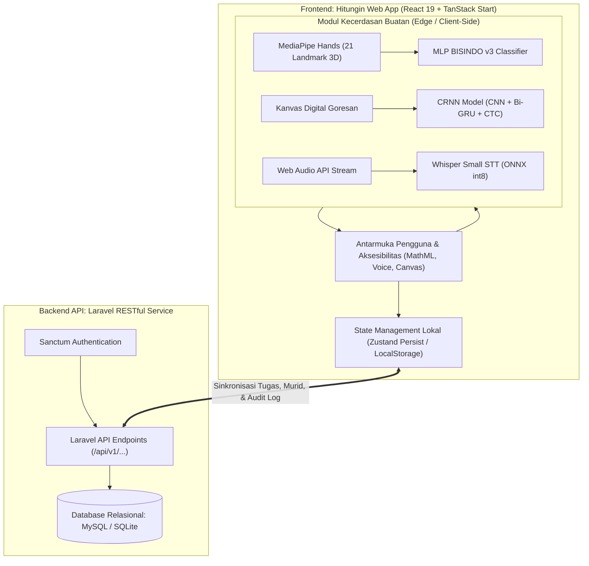

<div align="center">

# 🧮 HITUNGIN
### *NextGen Inclusive & Multimodal Mathematics Learning Platform*

**Kompetisi**: LOGICODIX 2026 Hackathon Competition  
**Tema**: *NextGen Digital Innovation: Crafting Creative Solutions for a Better Society*  
**Subtema**: *Smart & Fun Education* (Inovasi Pendidikan Inklusif Berbasis AI)  
**Kategori**: Web Application

---

[](https://react.dev/)
[](https://tanstack.com/)
[](https://tailwindcss.com/)
[](https://vitejs.dev/)
[](https://laravel.com/)

</div>

---

## 📌 Tautan Repositori & Layanan
- **Repositori Frontend (Web App & Edge AI)**: [mohamadarif03/hitungin (Saat ini)](https://github.com/mohamadarif03/hitungin)
- **Layanan Backend**: Menggunakan arsitektur RESTful API berbasis Laravel (otentikasi Sanctum, manajemen siswa, kelas, penugasan, dan audit trail).
- **Dokumentasi & Riset Model**:
  - [Dokumentasi Integrasi AI Lokal & Kontrak Model](docs/local-ai.md)
  - [Notebook Eksperimen CRISP-DM & Pelatihan Colab](notebooks/README.md)
  - [Dokumentasi Dataset Publik & Ketentuan Sumber](notebooks/DATASETS.md)

---

## 👥 Identitas Tim & Pengembang
* **Nama Tim**: Tim Hitungin Indonesia
* **Ketua Tim**: Mohamad Arif
* **Anggota Tim**:
  1. Mohamad Arif (*Fullstack Developer & AI Engineer*)

---

## 📖 Latar Belakang & Masalah yang Diangkat

Berdasarkan data statistik pendidikan inklusi (*Pusdatin Kemendikbudristek & JEL Hamzanwadi*), lebih dari **68% guru di kelas inklusi dan Sekolah Luar Biasa (SLB) menghadapi kendala berat akibat minimnya media ajar matematika yang adaptif**. Pembelajaran matematika konvensional masih didominasi teks visual satu arah dan interaksi keyboard standar yang tidak ramah disabilitas.

### 4 User Persona yang Menjadi Fondasi Hitungin:
1. **Ibu Ratna (Guru SLB & Koordinator Kelas Inklusi)**
   - **Tantangan**: Mengajar matematika kepada siswa dengan ragam kebutuhan khusus dalam satu kelas yang sama. Terbebani evaluasi manual satu per satu yang memakan waktu 3 kali lipat lebih lama.
   - **Solusi**: Portal Guru terintegrasi (`/guru`) dengan pemantauan analitik progres, riwayat akurasi, dan tinjauan audit AI berbasis *Human-in-the-Loop*.
2. **Rian (Siswa Tuli / Tunarungu, 10 Tahun)**
   - **Tantangan**: Riset *Krause & Wille (2021)* membuktikan siswa Tuli berisiko mengalami *math delay* 2–3 tahun akibat ketiadaan representasi gestur isyarat resmi (*SIBI/BISINDO*) dalam materi berhitung.
   - **Solusi**: Input latihan menggunakan **Isyarat Tangan Berbasis MediaPipe + MLP BISINDO** tanpa perlu keyboard.
3. **Dimas (Siswa Disgrafia & Hambatan Motorik Halus, 11 Tahun)**
   - **Tantangan**: Memiliki nalar berhitung cepat, namun nilai ujian digitalnya anjlok karena kesulitan menekan tuts keyboard sempit. Studi *Learnosity* membuktikan beban kognitif anak disgrafia naik 40% jika dipaksa mengetik daripada mencoret bebas.
   - **Solusi**: **Kanvas Tulisan Bilangan Digital** dengan pengenalan goresan alami bertenaga **CRNN (CNN + Bi-GRU + CTC)**.
4. **Aisyah (Siswi Tunanetra / Hambatan Visual, 12 Tahun)**
   - **Tantangan**: Formula matematika digital umumnya disimpan sebagai gambar tanpa teks alternatif. Riset *TalkMaths* (*Attanayake et al.*) membuktikan tunanetra membutuhkan waktu 3–5 kali lebih lama jika tidak didukung representasi semantik dan input suara.
   - **Solusi**: Notasi formula semantik berstandar **W3C MathML**, narasi suara sintetis (*Web Speech API*), serta **Input Suara Berbasis Whisper Small Indonesia (ONNX int8)**.

---

## 🧠 Arsitektur & Dokumentasi Kecerdasan Buatan (AI)

Hitungin menerapkan prinsip **Privacy-First & On-Device Client Inference**: ketiga model hasil training berjalan secara lokal pada browser pengguna tanpa mengirim rekaman kamera, kanvas, atau audio mikrofon ke server eksternal.

```
                  ┌────────────────────────────────────────────────────────┐
                  │                 MODALITAS AI HITUNGIN                  │
                  └──────────────────────────┬─────────────────────────────┘
                                             │
         ┌───────────────────────────────────┼───────────────────────────────────┐
         ▼                                   ▼                                   ▼
  1. INPUT ISYARAT                   2. INPUT TULISAN                    3. INPUT SUARA
┌──────────────────────┐           ┌──────────────────────┐            ┌──────────────────────┐
│  Kamera / Webcam     │           │  Kanvas Sentuh/Mouse │            │  Audio Mikrofon      │
└──────────┬───────────┘           └──────────┬───────────┘            └──────────┬───────────┘
           │                                  │                                   │
           ▼                                  ▼                                   ▼
┌──────────────────────┐           ┌──────────────────────┐            ┌──────────────────────┐
│   MediaPipe Hands    │           │ CNN Feature Extractor│            │ 80-Channel Log-Mel   │
│ (21 3D Landmark Pts) │           │ (Goresan Spasial)    │            │ Spectrogram Extractor│
└──────────┬───────────┘           └──────────┬───────────┘            └──────────┬───────────┘
           │                                  │                                   │
           ▼                                  ▼                                   ▼
┌──────────────────────┐           ┌──────────────────────┐            ┌──────────────────────┐
│  128 Fitur Geometri  │           │  Bi-Directional GRU  │            │ Whisper Small Indo   │
│ (Invarian Skala/Pos) │           │ (Konteks Sekuensial) │            │ (ONNX int8 Seq2Seq)  │
└──────────┬───────────┘           └──────────┬───────────┘            └──────────┬───────────┘
           │                                  │                                   │
           ▼                                  ▼                                   ▼
┌──────────────────────┐           ┌──────────────────────┐            ┌──────────────────────┐
│  MLP BISINDO v3      │           │     CTC Decoder      │            │  Parser Bilangan     │
│ (Digit 0-9 Latensi<30ms)         │ (Transkripsi Angka)  │            │  (Rentang 0 - 100)   │
└──────────────────────┘           └──────────────────────┘            └──────────────────────┘
```

| Jalur | Model & Data Pelatihan | Kontrak & Perilaku Browser |
| :--- | :--- | :--- |
| **Isyarat (Gesture)** | **MediaPipe Hand Landmarker + MLP BISINDO static numbers v3** | Deteksi dua tangan berurutan, ekstraksi 128 fitur geometri tangan, normalisasi relatif pergelangan; mengenali digit 0–9 dengan latensi < 30 ms. |
| **Tulisan (Handwriting)** | **CRNN (CNN + Bi-GRU + CTC)**, dilatih pada dataset gabungan MNIST & EMNIST digits | Menerima goresan bilangan utuh kanvas (putih di atas hitam, resolusi 32×96), dekoder CTC tanpa segmentasi manual antar-karakter. |
| **Suara (Speech)** | **Whisper Small Indonesia (Bagus/whisper-small-id-cv17 fine-tuned CDSR)** | Model diekspor ke format ONNX int8 encoder + KV cache merged decoder; input audio mono 16 kHz; parser otomatis bilangan 0–100. |
| **Semantik Rumus** | **W3C MathML** (`<math>`, `<mrow>`, `<mi>`, `<mo>`, `<mn>`) | Memungkinkan *screen reader* (NVDA, JAWS, VoiceOver) membaca susunan formula secara semantik matematis. |

---

## 🏛️ Arsitektur Sistem & Alur Data



---

## 💻 Panduan Penggunaan Web (User Flow)

### A. Alur Siswa (Belajar & Berlatih)
1. **Membuka Halaman**: Akses [http://localhost:3000](http://localhost:3000). Aplikasi langsung aktif dalam mode sesi siswa tanpa hambatan autentikasi kaku (*zero friction*).
2. **Memilih Materi**:
   - Klik menu **Materi** pada navigasi bawah atau bilah menu.
   - Peta materi tersusun dari Level 1 hingga Level 9 (SD sampai SMP). Tersedia pencarian materi *real-time* berbasis judul dan topik di bilah atas.
   - Klik kartu materi yang ingin dipelajari (misalnya **Level 8: Rumus Bangun Datar**).
3. **Mempelajari Konsep**:
   - Tekan tombol **"Dengarkan Penjelasan"** untuk mendengarkan narasi audio terintegrasi.
   - Pelajari formula semantik MathML dan ikuti contoh terpandu langkah demi langkah (*step-by-step*).
4. **Mengerjakan Latihan**:
   - Klik tombol **"Latihan Level Ini"**.
   - Pilih modalitas jawaban yang paling nyaman:
     - ✋ **Isyarat**: Aktifkan webcam, peragakan angka di depan kamera, jawaban otomatis terdeteksi via MediaPipe + MLP.
     - ✍️ **Tulisan**: Tuliskan angka secara bebas pada kanvas dengan mouse/stylus, tekan **"Periksa"**.
     - 🎙️ **Suara**: Tekan ikon mikrofon, sebutkan jawaban secara lisan dalam bahasa Indonesia.
     - ⌨️ **Keyboard**: Ketik manual angka pada kolom input teks standar.
   - Dapatkan umpan balik audio dan visual secara instan.

### B. Alur Guru (Ibu Ratna)
1. **Masuk ke Portal Guru**:
   - Buka rute [http://localhost:3000/guru](http://localhost:3000/guru) atau klik ikon Akun.
2. **Memantau Perkembangan Murid**:
   - Tab **Murid**: Melihat daftar murid (Rian, Dimas, Aisyah), total sesi latihan, dan modalitas yang sering digunakan anak.
   - Tab **Kelas**: Memantau rata-rata capaian akurasi dan distribusi materi.
3. **Membuat & Mengelola Penugasan**:
   - Mengatur target materi latihan matematika untuk kelas inklusi.
4. **Audit Human-in-the-Loop**:
   - Buka tab **Tinjau**: Memeriksa log penandaan pengenalan AI jika siswa menandai adanya kekeliruan pembacaan gestur/suara untuk dikonfirmasi atau dikoreksi oleh guru.

---

## 🛠️ Panduan Instalasi & Menjalankan Aplikasi

### 1. Menjalankan Frontend (Repositori Ini)
```bash
# Clone repositori frontend
git clone https://github.com/mohamadarif03/hitungin.git
cd hitungin

# Salin konfigurasi environment
cp .env.example .env

# Instal dependensi (gunakan --ignore-scripts untuk kestabilan)
npm ci --ignore-scripts

# Jalankan server pengembangan
npm run dev
```
Aplikasi frontend akan aktif di: **`http://localhost:3000`**

### 2. Menjalankan Backend (Laravel REST API)
Layanan backend REST API dapat dijalankan dengan langkah berikut:
```bash
# Pindah ke direktori backend
cd backend

# Instal dependensi PHP
composer install

# Konfigurasi environment & application key
cp .env.example .env
php artisan key:generate

# Migrasi dan isi data awal database
php artisan migrate --seed

# Jalankan server backend API
php artisan serve
```
Backend API akan berjalan di: **`http://localhost:8000`**

---

## 🔐 Akun Demonstrasi (Demo Accounts)

| Peran | Alamat Akses | Kredensial | Keterangan |
| :--- | :--- | :--- | :--- |
| **Siswa (Rian/Dimas/Aisyah)** | `/` atau `/materi` | **Bebas Akses (No barrier)** | Default sesi aktif: *Siswa • Kelas 4 SD*. |
| **Guru (Ibu Ratna)** | `/guru` | **Email**: `ratna@contoh.sch.id`<br>**Sandi**: `demo1234` | Akses penuh dashboard guru, kelas, tugas, dan audit log. |

---

## 🛡️ Etika, Keamanan Digital, & Atribusi

1. **Privasi Siswa (Zero Video/Audio Upload)**:
   - Pengenalan isyarat tangan dan audio diproses sepenuhnya di browser (*on-device client-side inference*). Tidak ada rekaman webcam atau mikrofon yang disimpan atau dikirim ke internet.
2. **Prinsip Human-in-the-Loop**:
   - Keputusan model AI tidak menghakimi nilai secara sepihak. Guru memiliki kontrol penuh melalui menu audit untuk mengoreksi hasil pengenalan sistem.
3. **Atribusi Sumber Daya**:
   - **Frontend & UI**: React 19, TanStack Start & Router, Vite 8, Tailwind CSS v4, Lucide Icons.
   - **Backend**: Laravel Framework, Laravel Sanctum, SQLite / MySQL.
   - **Model & Runtime AI**: Google MediaPipe Hands, ONNX Runtime Web, Whisper Small Indonesia (fine-tuned on CDSR), CRNN (MNIST + EMNIST Digits).
   - **Aksesibilitas**: W3C MathML Specification, Web Speech API.

---

<div align="center">
<b>HITUNGIN © 2026 — Dibuat untuk Generasi Emas Inklusif Indonesia 🇮🇩</b>
</div>
