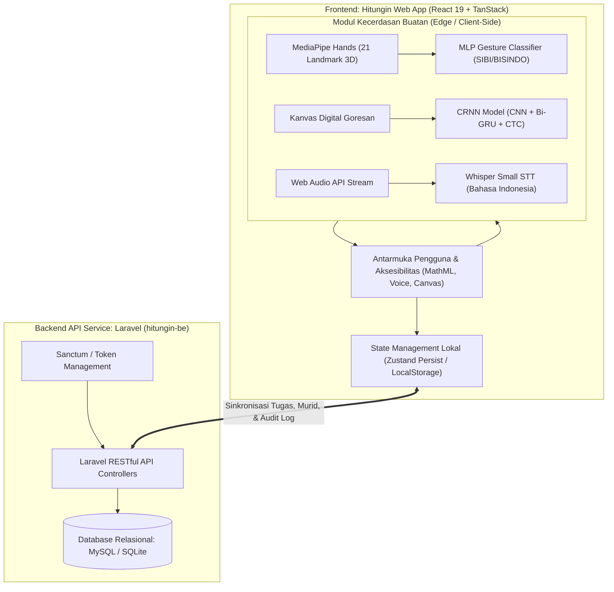

<div align="center">

# 🧮 HITUNGIN
### *NextGen Inclusive & Multimodal Mathematics Learning Platform*

**Kompetisi**: LOGICODIX 2026 Hackathon Competition  
**Tema**: *NextGen Digital Innovation: Crafting Creative Solutions for a Better Society*  
**Subtema**: *Smart & Fun Education* (Inovasi Pendidikan Inklusif Berbasis AI)  
**Kategori**: Web Application

---

[](https://react.dev/)
[](https://tanstack.com/)
[](https://tailwindcss.com/)
[](https://vitejs.dev/)
[](https://github.com/mohamadarif03/hitungin-be)

</div>

---

## 📌 Tautan Penting
- **Repositori Frontend**: [mohamadarif03/hitungin (Saat ini)](https://github.com/mohamadarif03/hitungin)
- **Repositori Backend (Laravel)**: [mohamadarif03/hitungin-be](https://github.com/mohamadarif03/hitungin-be)  
  *Seluruh layanan backend RESTful API, database relasional, manajemen kelas, dan endpoint integrasi pendukung dibangun menggunakan framework **Laravel** dan dapat diakses pada repositori tersebut.*

---

## 👥 Identitas Tim & Anggota
* **Nama Tim**: Tim Hitungin Indonesia
* **Ketua Tim**: Mohamad Arif
* **Anggota Tim**:
  1. Mohamad Arif (*Fullstack Developer & AI Engineer*)

---

## 📖 Latar Belakang & Masalah yang Diangkat

Berdasarkan data statistik pendidikan inklusi nasional (*Pusdatin Kemendikbudristek & JEL Hamzanwadi*), lebih dari **68% guru di kelas inklusi dan Sekolah Luar Biasa (SLB) menghadapi kendala berat akibat minimnya media ajar matematika yang adaptif**. Pembelajaran matematika konvensional masih didominasi buku teks visual statis dan masukan keyboard standar yang tidak ramah disabilitas.

### 4 User Persona Nyata yang Menjadi Fondasi Hitungin:
1. **Ibu Ratna (Guru SLB & Kelas Inklusi)**
   - **Tantangan**: Mengajar matematika kepada siswa dengan ragam kebutuhan khusus dalam satu kelas yang sama. Terbebani evaluasi manual satu per satu yang memakan waktu 3x lipat lebih lama.
   - **Solusi**: Portal Guru terintegrasi dengan pemantauan analitik progres, riwayat akurasi, dan tinjauan audit AI berbasis *Human-in-the-Loop*.
2. **Rian (Siswa Tuli / Tunarungu, 10 Tahun)**
   - **Tantangan**: Studi *Krause & Wille (2021)* menunjukkan siswa Tuli berisiko mengalami *math delay* 2–3 tahun akibat ketiadaan representasi gestur isyarat resmi (*SIBI/BISINDO*) dalam materi berhitung.
   - **Solusi**: Input latihan menggunakan **Isyarat Tangan Berbasis MediaPipe + MLP** tanpa keyboard.
3. **Dimas (Siswa Disgrafia & Hambatan Motorik Halus, 11 Tahun)**
   - **Tantangan**: Memiliki nalar berhitung cepat, namun nilai ujian digitalnya anjlok karena kesulitan menekan tuts keyboard sempit. Studi *Learnosity* membuktikan beban kognitif anak disgrafia naik 40% jika dipaksa mengetik daripada mencoret bebas.
   - **Solusi**: **Kanvas Tulisan Bilangan Digital** dengan pengenalan goresan alami bertenaga **CRNN (CNN + Bi-GRU + CTC)**.
4. **Aisyah (Siswi Tunanetra / Hambatan Visual, 12 Tahun)**
   - **Tantangan**: Formula matematika digital umumnya disimpan sebagai gambar tanpa teks alternatif. Riset *TalkMaths* (*Attanayake et al.*) membuktikan tunanetra membutuhkan waktu 3–5 kali lebih lama jika tidak didukung representasi semantik dan input suara.
   - **Solusi**: Notasi formula semantik berstandar **W3C MathML**, narasi suara sintetis (*Web Speech*), serta **Input Suara Berbasis Whisper Small Indonesia**.

---

## 🧠 Dokumentasi Penggunaan Kecerdasan Buatan (AI)

Hitungin mengintegrasikan arsitektur kecerdasan buatan multimodal yang disesuaikan secara presisi dengan hambatan fisik masing-masing siswa:

```
                  ┌────────────────────────────────────────────────────────┐
                  │                 MODALITAS AI HITUNGIN                  │
                  └──────────────────────────┬─────────────────────────────┘
                                             │
         ┌───────────────────────────────────┼───────────────────────────────────┐
         ▼                                   ▼                                   ▼
  1. INPUT ISYARAT                   2. INPUT TULISAN                    3. INPUT SUARA
┌──────────────────────┐           ┌──────────────────────┐            ┌──────────────────────┐
│  Kamera / Webcam     │           │  Kanvas Sentuh/Mouse │            │  Audio Mikrofon      │
└──────────┬───────────┘           └──────────┬───────────┘            └──────────┬───────────┘
           │                                  │                                   │
           ▼                                  ▼                                   ▼
┌──────────────────────┐           ┌──────────────────────┐            ┌──────────────────────┐
│   MediaPipe Hands    │           │ CNN Feature Extractor│            │ 80-Channel Log-Mel   │
│ (21 3D Landmark Pts) │           │ (Goresan Spasial)    │            │ Spectrogram Extractor│
└──────────┬───────────┘           └──────────┬───────────┘            └──────────┬───────────┘
           │                                  │                                   │
           ▼                                  ▼                                   ▼
┌──────────────────────┐           ┌──────────────────────┐            ┌──────────────────────┐
│   Normalisasi Wrist  │           │  Bi-Directional GRU  │            │ Whisper Small Indo   │
│ (Invarian Skala/Pos) │           │ (Konteks Sekuensial) │            │ (Seq2Seq Transformer)│
└──────────┬───────────┘           └──────────┬───────────┘            └──────────┬───────────┘
           │                                  │                                   │
           ▼                                  ▼                                   ▼
┌──────────────────────┐           ┌──────────────────────┐            ┌──────────────────────┐
│    MLP Classifier    │           │     CTC Decoder      │            │  Tokenisasi Numerik  │
│  (SIBI & BISINDO)    │           │ (Transkripsi Angka)  │            │  Bahasa Indonesia    │
└──────────────────────┘           └──────────────────────┘            └──────────────────────┘
```

### 1. Modalitas Isyarat: MediaPipe Hands + Multi-Layer Perceptron (MLP)
- **Komponen**: Google MediaPipe Hands & Lightweight Edge MLP.
- **Mekanisme**:
  - Pustaka MediaPipe mendeteksi tangan pada frame kamera dan mengekstraksi 21 titik koordinat 3D (*wrist*, buku-buku jari, hingga ujung jari) secara *real-time* langsung di browser siswa.
  - Vektor koordinat dinormalisasi terhadap titik pergelangan tangan (*wrist-relative normalization*) agar invarian terhadap jarak kamera maupun ukuran tangan anak.
  - Model MLP (Multi-Layer Perceptron) dengan latensi < 30 ms mengklasifikasikan formasi jari ke kelas bilangan isyarat sistem SIBI dan BISINDO.
- **Keunggulan Privasi**: Seluruh komputasi visual diproses lokal di sisi klien (*client-side on-device*), tidak ada data frame video yang disimpan atau dikirim ke internet.

### 2. Modalitas Tulisan Tangan: CRNN (CNN + Bi-Directional GRU + CTC)
- **Komponen**: Convolutional Recurrent Neural Network dengan Connectionist Temporal Classification.
- **Mekanisme**:
  - **CNN**: Mengekstraksi fitur visual morfologi dan arah goresan dari matriks piksel kanvas.
  - **Bi-Directional GRU (Gated Recurrent Unit)**: Membaca ketergantungan urutan sekuensial dari kiri ke kanan dan kanan ke kiri, menangkap hubungan antardigit tanpa memerlukan pemotongan (*character segmentation*) manual.
  - **CTC Loss & Greedy Decoder**: Memetakan representasi probabilitas sekuensial menjadi teks digit numerik akhir secara fleksibel.
- **Keunggulan**: Memungkinkan anak disgrafia menulis secara bersambung dan bebas ukuran tanpa batasan kotak kolom ketik.

### 3. Modalitas Suara: Whisper Small Indonesia Pretrained
- **Komponen**: OpenAI Whisper (varian Small, ~244M parameter) yang dioptimasi untuk penutur Bahasa Indonesia.
- **Mekanisme**:
  - Rekaman audio ucapan dipecah menjadi spektrogram log-Mel 80-kanal.
  - Arsitektur Transformer Sequence-to-Sequence (Encoder-Decoder) memetakan gelombang akustik langsung ke teks fonetik bahasa Indonesia.
  - Post-processing parser mengubah kata bilangan verbal (contoh: *"dua puluh lima"*) menjadi representasi bilangan terstruktur (`25`).
- **Keunggulan**: Sangat tahan (*robust*) terhadap interferensi kebisingan kelas/rumah tangga dan artikulasi anak berkebutuhan khusus.

### 4. Semantik Formula: Standar W3C MathML
- Seluruh rumus di halaman materi ditulis menggunakan tag semantik `<math>`, `<mrow>`, `<mi>`, `<mo>`, dan `<mn>` standar W3C.
- Memungkinkan *screen reader* (NVDA, JAWS, VoiceOver, TalkBack) membacakan simbol matematis secara runtut (misal: "dua x ditambah enam sama dengan enam belas"), bukan sekadar teks acak.

---

## 🚀 Fitur Utama Aplikasi

1. **Peta Materi Berjenjang (Level 1 s/d 9)**:
   - Mulai dari Penjumlahan & Pengurangan Dasar SD hingga Aljabar Linear Satu Variabel (PLSV) dan Teorema Pythagoras SMP.
   - Dilengkapi panduan terpandu langkah demi langkah (*step-by-step interactive walk-through*).
2. **Antarmuka Mobile-First 100% Responsif**:
   - Hero pattern ungu modern, watermark ikon matematika ramah anak, dan *floating action navigation*.
   - Pencarian materi *real-time* berbasis topik, judul, dan formula contoh.
3. **Sesi Latihan Multimodal Bebas Hambatan**:
   - Siswa bebas memilih metode input yang paling sesuai: **Isyarat Tangan**, **Tulisan Kanvas**, **Suara**, atau **Keyboard Standar**.
   - Sistem validasi instan, bantuan bertingkat (*tiered hints*), dan pencatatan akurasi otomatis.
4. **Portal Guru Inklusif (`/guru`)**:
   - Manajemen daftar murid, pantauan kelas, dan tugas daring.
   - Grafik analitik capaian kompetensi serta pemetaan jalur input favorit siswa.
   - Fitur **Human-in-the-Loop Audit** untuk meninjau log pengenalan AI yang diberi tanda (*flagged*).
5. **Menu Aksesibilitas Universal**:
   - Pengaturan kontras tampilan, ukuran teks adaptif, dan pembacaan teks audio (*Text-to-Speech*).

---

## 🏛️ Arsitektur Sistem & Alur Data



---

## 💻 Panduan Penggunaan Web (User Flow)

### A. Alur Siswa (Belajar & Berlatih)
1. **Membuka Halaman**: Buka [http://localhost:3000](http://localhost:3000). Aplikasi langsung aktif dalam mode sesi siswa siap pakai.
2. **Memilih Materi**:
   - Klik menu **Materi** pada navigasi bawah atau bilah atas.
   - Telusuri jenjang materi dari Level 1 hingga Level 9 (SD sampai SMP). Gunakan fitur pencarian di bilah atas jika diperlukan.
   - Klik kartu materi (misalnya **Level 8: Rumus Bangun Datar**).
3. **Mempelajari Konsep**:
   - Tekan tombol **"Dengarkan Penjelasan"** untuk mendengarkan narasi audio.
   - Amati formula semantik MathML, visualisasi garis bilangan, dan klik **"Berikutnya"** pada contoh terpandu langkah-demi-langkah.
4. **Mengerjakan Latihan**:
   - Klik tombol **"Latihan Level Ini"**.
   - Pilih modalitas jawaban yang diinginkan di bawah soal:
     - **Isyarat**: Nyalakan webcam, peragakan angka di depan kamera, jawaban otomatis terdeteksi.
     - **Tulisan**: Coretkan angka bebas pada kanvas menggunakan mouse/stylus, tekan **"Periksa Jawaban"**.
     - **Suara**: Tekan tombol mikrofon, sebutkan jawaban secara lisan.
     - **Keyboard**: Ketik manual angka pada kolom input.
   - Dapatkan umpan balik audio dan visual secara instan.

### B. Alur Guru (Ibu Ratna)
1. **Masuk ke Portal Guru**:
   - Akses rute [http://localhost:3000/guru](http://localhost:3000/guru) atau klik ikon Akun pada navigasi bawah.
2. **Memantau Perkembangan Murid**:
   - Buka tab **Murid**: Lihat daftar murid (Rian, Dimas, Aisyah), total latihan selesai, dan modalitas yang sering digunakan.
   - Buka tab **Kelas**: Pantau rata-rata akurasi kelas dan distribusi pemahaman konsep.
3. **Membuat & Meninjau Tugas**:
   - Guru dapat membuat target tugas latihan matematika dengan level tertentu.
4. **Audit Human-in-the-Loop**:
   - Buka menu **Tinjau**: Periksa log penandaan pengenalan AI jika siswa menandai adanya kekeliruan pembacaan gestur/suara untuk evaluasi manual.

---

## 🛠️ Panduan Instalasi & Menjalankan Aplikasi

### Prasyarat Sistem
- **Node.js**: Versi `>= 18.0.0` (disarankan Node.js 20 LTS atau 22 LTS).
- **Package Manager**: `npm`, `pnpm`, atau `bun`.
- **Git**

### 1. Menjalankan Frontend (Repositori Ini)
```bash
# 1. Clone repositori frontend
git clone https://github.com/mohamadarif03/hitungin.git
cd hitungin

# 2. Salin variabel lingkungan
cp .env.example .env

# 3. Instal dependensi
npm install

# 4. Jalankan server pengembangan
npm run dev
```
Aplikasi frontend akan aktif di: **`http://localhost:3000`**

### 2. Menjalankan Backend (Laravel REST API)
Layanan backend terpisah di repositori [mohamadarif03/hitungin-be](https://github.com/mohamadarif03/hitungin-be):
```bash
# 1. Clone repositori backend
git clone https://github.com/mohamadarif03/hitungin-be.git
cd hitungin-be

# 2. Instal dependensi PHP Composer
composer install

# 3. Konfigurasi Environment & Key
cp .env.example .env
php artisan key:generate

# 4. Jalankan Migrasi & Database Seeder
php artisan migrate --seed

# 5. Jalankan Server API
php artisan serve
```
Backend API akan berjalan di: **`http://localhost:8000`**

---

## 🔐 Akun Demonstrasi (Demo Accounts)

Untuk mempermudah dewan juri dalam menguji aplikasi secara langsung:

| Peran | Alamat URL / Akses | Kredensial Masuk | Catatan |
| :--- | :--- | :--- | :--- |
| **Siswa (Rian/Dimas/Aisyah)** | `/` atau `/materi` | **Bebas Akses (No Auth Barrier)** | Langsung aktif dengan profil *Siswa • Kelas 4 SD*. |
| **Guru (Ibu Ratna)** | `/guru` | **Email**: `ratna@contoh.sch.id`<br>**Sandi**: `demo1234` | Akses penuh dashboard guru, kelas, tugas, dan audit log. |

---

## 🛡️ Etika, Keamanan Digital, & Atribusi

1. **Privasi Siswa (Zero Video Upload)**:
   - Pengenalan isyarat tangan melalui MediaPipe dijalankan sepenuhnya secara lokal di peramban (*on-device client-side inference*). Tidak ada rekaman webcam siswa yang ditransmisikan ke server pihak ketiga.
2. **Prinsip Human-in-the-Loop**:
   - Keputusan AI tidak bersifat mutlak. Guru memiliki kendali verifikasi manual melalui menu audit untuk memastikan keadilan evaluasi (*fairness in AI*).
3. **Atribusi Sumber Daya & Pustaka Pihak Ketiga**:
   - **Framework & Runtime**: React 19, TanStack Start & Router, Vite, Laravel Framework.
   - **Styling & Ikonografi**: Tailwind CSS v4, Lucide React Icons.
   - **Model & Pustaka AI**: Google MediaPipe Hands, CRNN CTC Architecture, OpenAI Whisper (Indonesian fine-tuned weights).
   - **Aksesibilitas Semantik**: W3C MathML Specification, Web Speech Synthesis & Recognition API.

---

<div align="center">
<b>HITUNGIN © 2026 — Dibuat dengan cinta dan empati untuk Generasi Emas Inklusif Indonesia 🇮🇩</b>
</div>
